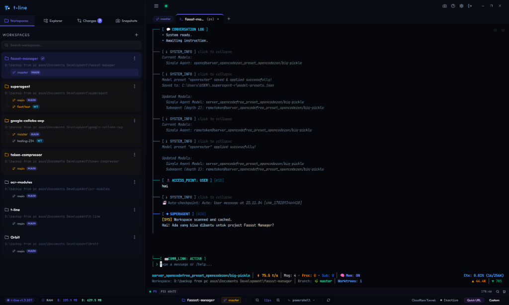

# t-line — Developer Workspace & SuperAgent AI Orchestrator

[](LICENSE)
[](https://tauri.app)
[](https://bun.sh)
[](https://react.dev)
[](https://www.typescriptlang.org)

> **t-line** is a high-performance developer workspace manager, GPU-accelerated terminal dashboard, Git worktree orchestrator, and **SuperAgent AI Integration Platform**. Built with Tauri v2, Bun, Express, and React, t-line seamlessly bridges deep terminal execution with multi-agent AI workflows.



---

## ✨ Key Features

### 🤖 SuperAgent AI Orchestration
* **Full HTTP & WebSocket Proxy Bridge**: Seamlessly connects to SuperAgent's port 7888 REST & SSE APIs (45+ endpoints).
* **Multi-Agent Tree Visualizer**: Real-time interactive visualization of subagents, superagent instances, process states, and execution DAGs.
* **100% Server-Proxy Configuration**: Centralized management of provider models, API profiles, system prompts, presets, and MCP servers without direct file mutation.
* **RMemory & Context Inspector**: Live browsing of short-term (L0), long-term (L1), and scene block (L2) AI agent memory.
* **Interactive Tool Approvals**: Real-time permission handling, question-answering prompts, and plan approval gates embedded into the streaming chat UI.

### 🖥️ High-Performance GPU Terminal
* **xterm.js Engine**: Canvas & WebGL GPU rendering with WebSockets PTY support.
* **Flexible Grid Layouts**: Split screen vertical/horizontal grids, tabbed terminals, and floating subagent console windows.
* **Cross-Platform PTY**: Built-in support for PowerShell, Git Bash, zsh, bash, and custom developer environments.

### 🌿 Git Worktree & Repository Orchestrator
* **Parallel Worktree Management**: Create, list, switch, prune, and delete Git worktrees without context switching.
* **Visual Diff & File Inspector**: Side-by-side git diff viewer, visual branch history graphs, stage/unstage controls, and fast commit actions.
* **Workspace Checkpoints**: Instant workspace state save & restoration via lightweight git stash integration.

### 🌐 Embedded Browser & DevTools
* **Autonomous Web Scraping & Control**: Integrated Chrome extension listener, Network XHR logger, Console log inspector, and HTML/Markdown page extractor.
* **Tab & Viewport Emulation**: Test mobile/tablet/desktop viewports and inspect privacy-masked storage/cookies directly from the t-line sidebar.
* **Browser V2 Diagnostics**: Native Tauri WebView2 supports request-scoped Storage Inspector responses and bounded Fetch/XHR Network metadata; sensitive keys and cookie values are masked, query strings/headers/bodies omitted. Screenshot capture uses Electron direct capture or the explicit OS window/screen picker in Tauri, with the WebView left visible.
* **Multi-Agent Browser Sessions**: Monitor and manage authorized SuperAgent Chrome-CDP shared sessions, roles, invitations and handover. Chrome CDP targets and Tauri WebView2 tabs are separate rendering engines and do not share session cookies. See [Browser V2 acceptance matrix](docs/plans/2026-10-25-tline-browser-v2.md).
* **Managed Browser Gateway Pairing (experimental):** In the Windows T-Line Browser panel, enable Managed Browser, launch an isolated real Chrome window, refresh its tabs and choose **Pair agent**. After explicit confirmation, T-Line routes the native-verified target instruction directly to a chat session in the **same workspace** (opening its agent tab if needed); if workspace routing is unavailable, **Copy for assistant** remains available. The prompt is delivered only when the existing chat WebSocket and model preset are ready, expires after 60 seconds, and does not overwrite the user's draft or local prompt history. The assistant must still use the authorized `superagent_browser_gateway` to `discover` and `claim` (or request approved shared access). Only an observed gateway claim confirms attachment; an automatic claim/permission grant is **not** provided by this UI. Chrome runs in a separate desktop window. Only use on a trusted local machine: loopback CDP itself is not authenticated. See [M2 pairing checkpoint](docs/plans/2026-10-25-tline-browser-m2-pairing-checkpoint.md) and [M2-B assistant request](docs/plans/2026-10-25-tline-browser-m2b-assistant-handoff.md).

**Native Core registration (M2-C):** The confirmed Pair agent action now requires an authenticated announcement from Tauri's Rust process to the local Core service before automatically requesting the workspace assistant to attach. Core validates the page target and publishes 90-second, token-free entries to the cross-process registry readable via the MCP gateway's `managed` action. The UI revalidates every 45 seconds while open. A registry entry is **not** a CDP claim; the MCP agent still needs normal target ownership/approval. If Core is unavailable, pairing fails closed to manual instructions. See [M2-C acceptance notes](docs/plans/2026-10-25-tline-browser-m2c-native-registry.md).

### 🔐 Security & Remote Workspace Sharing
* **Cloudflare Tunnel Integration**: Share your local dev server, terminal sessions, and workspace remotely with zero-trust access tokens and password protection.
* **Tauri v2 Desktop Native**: Native C++/Rust desktop wrapper keeping RAM footprint under 100MB with system tray support.

---

## 🧠 SuperAgent Brain Explorer — Tasks, Artifacts and Credentials

T-Line exposes SuperAgent's owner-scoped Brain as a **native desktop panel**. In the SuperAgent console, type `/brain` or `/scratch` *without additional arguments* to open Brain Explorer. It provides session/file navigation, artifact preview and upload, search, storage/retention, privacy-safe seven-day activity metrics, and multi-agent task management.

From **Multi-agent tasks**, you can create a task with logical agent members, claim exclusive ownership, record checkpoints, hand off finalized artifacts with SHA-256, transfer a task and mark it complete. Running tasks display persisted CLI Bridge status with periodic refresh. The task panel supports 24-hour agent credentials, one-time token display on creation/rotation, explicit confirmation before rotate/revoke, and status/expiration visibility. Tokens are **not** stored in browser localStorage or returned in task listings. The desktop operator is authenticated in the local `local-cli` namespace; a remote MCP agent must present its own task credential for mutations.

**Phase 7 recovery and audit.** Brain Task Panel now marks unresolved delegated launches for review. Its *Attach verified job* action requires explicit confirmation and only works when the persisted CLI Bridge idempotency key and task working directory match; it never runs a retry. The credentials panel displays redacted, bounded issue/rotate/revoke/recovery audit events. CLI slash commands `/brain task.launch.inspect` and `/brain task.launch.recover` remain CLI-only in the desktop console.

**Autocomplete and limitations.** T-Line loads the `/brain` and `/scratch` nested suggestion tree from `frontend/src/generated/brainCommandSuggestions.json`, generated by SuperAgent's canonical `commandCatalog.ts`. Nested CLI-only slash commands appear in suggestions but are **not** executed through the T-Line console: run them in the actual SuperAgent CLI, or use the corresponding native Brain Explorer control. Entering an unsupported nested command displays a notice instead of silently sending it as an agent prompt. Type `/brain help` inside the SuperAgent CLI for full syntax.

**Source integrity & release verification:**

```bash
# In sibling SuperAgent repository, synchronize (or verify) the Brain source + suggestion catalog:
bun scripts/sync-brain-runtime.ts --check
bun scripts/verify-brain-release.ts --with-tline

# In this t-line repository:
bun scripts/check-brain-runtime.cjs
bun --bun x vitest run backend/tests/brainExplorerRoutes.test.ts
cd frontend && bun --bun x vitest run --config vite.config.ts src/components/__tests__/SuperAgentCliParity.test.ts
```

The integrity gate checks generated Brain backend files and the suggestions checksum pinned in `backend/src/brain-runtime-manifest.json`. Builds and loopback tests do **not** substitute for authenticated OAuth testing on the public tunnel or a packaged desktop acceptance test. Brain scratch isolation is not an OS-level sandbox.

See [Brain unification and UI endpoints](docs/2026-10-22-tline-brain-unification.md) for implementation details.

**Session-safe agent mode changes (P0):** Switching between Single Agent and Multi-Agent Master opens a new chat session rather than restarting the shared Core. Existing agent sessions are not intentionally aborted by that mode switch. Process startup flags still require an explicit supervised restart.

**Session-scoped Assistant task drafts:** Open **Assistant task drafts (planning only)** in the chat console to save, inspect and cancel queued task *drafts* for that exact workspace/session. The backend uses authenticated, fixed-action proxies to the Core journal; it cannot run arbitrary commands. Core must be running with this API version. `executionEnabled: false` means these are not running workers, and task status remains separate from the existing live cross-channel monitor. The next phase will bind authorized agent workers and reconcile execution evidence. See [the implementation roadmap](docs/plans/2026-10-25-persistent-parallel-assistant-workspace.md).

---

## 🏗️ Architecture Overview

```text
┌─────────────────────────────────────────────────────────┐
│                    t-line Desktop                       │
│        (Tauri v2 Native Wrapper / Web UI)               │
└───────────────────────────┬─────────────────────────────┘
                            │ WebSocket / REST API
                            ▼
┌─────────────────────────────────────────────────────────┐
│                    t-line Backend                       │
│                (Express.js + Bun Runtime)               │
├───────────────────────────┬─────────────────────────────┤
│ • Terminal Manager (PTY)  │ • superAgentBridge.ts       │
│ • Git Worktree Manager    │ • superAgentRoutes.ts       │
│ • Cloudflare Tunnel Proxy │ • File Explorer & Checkpoint│
└───────────────────────────┴──────────────┬──────────────┘
                                           │ HTTP/SSE (port 7888)
                                           ▼
                            ┌─────────────────────────────┐
                            │    SuperAgent Engine        │
                            │  (AI Agent & Subagent Core) │
                            └─────────────────────────────┘
```

---

## 🚀 Quick Start

### Prerequisites
* [Bun](https://bun.sh) `1.4.2+` (tested runtime for CLI, backend and frontend; optional third-party integrations can require other runtimes)
* [Rust](https://www.rust-lang.org/) (required only for building Tauri v2 desktop binaries)
* [Git](https://git-scm.com/)

### Installation & Development Run

1. **Clone the Repository**
   ```bash
   git clone https://github.com/RudyCity/t-line.git
   cd t-line
   ```

2. **Install Dependencies**
   ```bash
   bun install --frozen-lockfile
   ```

3. **Start Backend + Frontend Development Servers (separate terminals)**
   ```bash
   bun run dev:backend
   # Open a second terminal:
   bun run dev:frontend
   ```
   These run the Bun backend and Vite frontend. To start the bundled CLI instead, run `bun run dev`.

4. **Launch Desktop App (Optional)**
   ```bash
   bun run tauri dev
   ```
   `bun run tauri dev` invokes Tauri through the `desktop-tauri` workspace. Alternatively `bun run dev:tauri` starts desktop + development servers, **but `dev.cjs` forcibly terminates listeners on ports 5773/5779 and existing T-Line desktop processes before launching**. Do not use `dev:tauri` on a shared or actively used host. Verify there are no other sessions first; prefer separate dev servers and an explicitly controlled desktop test.

   Production build: `bun run build:tauri` (requires Rust and platform desktop toolchains).

---

## 📁 Repository Structure

```text
t-line/
├── backend/                  # Express.js backend server
│   ├── src/
│   │   ├── server.ts          # Backend entrypoint & API router
│   │   ├── superAgentBridge.ts# SuperAgent lifecycle & SSE bridge
│   │   ├── superAgentRoutes.ts# 100% REST proxy for SuperAgent port 7888
│   │   ├── terminalManager.ts # xterm.js PTY process manager
│   │   ├── gitManager.ts      # Git worktree & branch operations
│   │   └── tunnelManager.ts   # Cloudflare Tunnel integration
├── frontend/                 # React 18 + Vite frontend UI
│   ├── src/
│   │   ├── components/        # UI components (SuperAgent Console, Worktrees, Terminal Grid)
│   │   ├── hooks/             # Custom React hooks (terminals, git, web sockets)
│   │   └── services/          # WebSocket & HTTP API client modules
├── desktop-tauri/            # Tauri v2 Rust desktop configuration and CLI
├── CHANGELOG.md              # Project version & release history
└── package.json              # Project workspace dependencies & scripts
```

---

## 📝 Configuration & Integration Rules

* **Single Source of Truth**: All SuperAgent configurations, presets, memory, and model profiles are proxied via `superAgentRoutes.ts` to port 7888. The t-line backend never mutates user config files directly.
* **Strict Code Quality**: Maximum file length limit is set to 1000 LOC per module to enforce modular architecture and maintainability.

---

## 🤝 Contributing

Contributions are welcome! Please make sure to test your code and follow the guidelines specified in `AGENTS.md`.

1. Fork the repo
2. Create a feature branch (`git checkout -b feature/amazing-feature`)
3. Commit your changes (`git commit -m 'Add amazing feature'`)
4. Push to the branch (`git checkout -b feature/amazing-feature`)
5. Open a Pull Request

---

## 📄 License & Author

Developed by **Rudy City** ([@RudyCity](https://github.com/RudyCity)) • 📧 Contact: [hrudy715@gmail.com](mailto:hrudy715@gmail.com)

Distributed under the [MIT License](LICENSE).

### Strict Windows OS isolation for managed SuperAgent

T-Line normally starts its managed SuperAgent server using the T-Line backend's Windows process identity. If `SUPERAGENT_REQUIRE_OS_SANDBOX=1` is set, startup now verifies `SUPERAGENT_OS_RUNNER_IDENTITY` matches `whoami.exe` and that opening the existing `SUPERAGENT_OS_DENIED_PROBE_PATH` returns an actual permission denial (`EACCES`/`EPERM`). The backend refuses to start managed SuperAgent otherwise. To activate this policy, run the **T-Line backend itself** as a dedicated restricted Windows user and configure folder ACL restrictions for that user; the check does **not** magically spawn under another account and it does not modify ACLs. For setup and caveats, see the SuperAgent repository README, section "Strict OS sandbox startup gate". Do not assume this sample probe proves comprehensive isolation or protects separate Chrome/CDP processes.

### SuperAgent Studio — web animation code export

From the Studio tab, select a vector/text/path-only project, choose **Autoplay**,
**Scroll**, **Click** or **Hover**, then **Export Web Code**. The T-Line
frontend downloads the authenticated offline HTML/SVG or sandboxed React TSX export as a local file; it
never places its bearer token in a browser URL. The export needs an updated
SuperAgent Studio backend exposing `studioToCodeExport=svg-native-html-v2`.
The generated HTML uses a first-party native browser runtime and works offline; it is not a video-to-code AI
reconstruction, and raster/video/audio inputs are intentionally rejected.
Existing Studio MP4 rendering and download remain available.

**Interaction Graph v1:** Updated SuperAgent Studio backends advertise
`studioInteractionRules=declarative-bindings-v1` and the T-Line Studio tab
shows a rules panel. Choose an event (load/click/hover enter/leave/focus/scroll),
a stage or text/vector layer target, and play/pause/replay/seek. Up to 12 rules
are saved as revisioned Studio project data and used by offline HTML and React
exports. Invalid/dangling layer targets are rejected server-side. This is a
declarative rules panel, not the planned free-form graph/state-machine editor.

**Code → MP4 render queue and optional audio:** The Studio editor now submits bounded asynchronous jobs (up to one render active, three waiting). It polls status with completed/total frames, offers Cancel, and downloads the MP4 on completion. A local, canonical PCM16 WAV file can be uploaded as an optional Studio audio asset, then encoded/muxed as AAC 128 kbps in the MP4. This does not capture browser-generated audio. Job metadata is memory-only and lost on backend restart; installed-app click-through E2E and long render reliability are not signed off.

**Code → MP4 (developer preview):** In Studio, the **Code → MP4** panel appears if the backend reports `studioCodeToVideo=offline-chromium-ffmpeg-preview-v1` and `localCodeToVideoReady=true`. It can render the current Studio scene (identical to its HTML/React wrapper) or a self-contained, explicitly trusted local `.html` or **Studio-exported** `.tsx`. External React/Next.js source must be compiled into a self-contained HTML build before rendering. Users can set width, height, FPS and duration, watch the MP4 preview and download it. Limits: 0.25–12s, max 300 frames, up to 1920×1080, H.264 MP4 without audio. Chrome/Edge/Chromium and FFmpeg must already be installed; no remote URLs or assets are loaded. This does not promise parity with arbitrary JS animation frameworks and is NOT a general hostile-HTML sandbox. The backend runs this preview synchronously, and installed-desktop click-through E2E remains unverified.

**Code-to-Video durable job history:** Current Studio backends persist only allowlisted job status/MP4 metadata per authorized workspace. Use the **Recent renders** section in Code → MP4 to refresh status or reopen completed MP4 without re-rendering. In-progress jobs lost to a backend restart display **interrupted** and require manual retry; no automatic rerun, cross-process scheduler or exactly-once guarantee. Authenticated `GET /api/studio/code-to-video/jobs` lists up to 20 jobs. Chrome/Edge and FFmpeg still required locally; production release remains gated.

**Experimental Video → Editable Studio Code:** On a backend advertising
`experimentalMultiVectorReconstruction=two-to-four-bright-separated-objects-api-v1`,
the Studio tab allows the user to select a **local MP4/WebM (1–12 seconds, up
to 12 MiB)** and click **Create editable layers**. The authenticated backend
tracks between 5 and 9 video frames (with additional samples on
high-motion intervals) to estimate 2–4 separated high-contrast colored or
dark shapes on a stable solid-color background, light or dark. Object/background
colors are preserved within codec tolerances. The source is sampled through
96% of the duration to detect late missing objects. Each shape receives
editable x/y keyframes. A private
comparison image shows three source/Studio frame pairs and foreground-mask
similarity scores, while up to two additional frames not used for tracking
are checked for interpolation drift. These scores are not a full-fidelity
guarantee. The UI rejects
oversized/unsupported files, limits API routes to the selected workspace, and
never exposes bearer tokens or source file paths in URLs. Changes do not
automatically publish to any website, run arbitrary video-to-code AI, or
replace the existing video renderer.

**Optional English OCR:** When the Studio backend advertises
`experimentalTextOcrReconstruction=local-english-stable-captions-v1`, the
**Extraction mode** menu adds `Editable Text (English OCR)`. It uses the
same authenticated 12-MiB video upload, then calls
`POST /api/studio/reconstruct/text` to create a new revisioned text-layer
project. The UI displays recognized lines and confidence scores. This requires
local Tesseract with `eng` language data; neither Tesseract nor language
packs are bundled with T-Line. For stable English captions only, confidence is
estimated and the recreated typography is approximate. User should review and
edit fonts/colors, positions and timing before publishing. Unsupported/changed
captions return an explicit failure without saving an incorrect project.

**Opt-in changing caption timeline:** Updated backends advertise
`experimentalTextOcrTimeline=local-english-caption-timeline-v1` and require
`localTextOcrReady=true`. Select **Caption timeline (changing OCR)** to
recover sequences where English captions change or disappear over time.
Nine bounded samples create separate editable text layers with estimated
step-opacity visibility intervals, and the editor lists each caption and
its approximate start/end frame. Single-sample OCR readings and unsupported
scene changes fail rather than saving untrusted captions. Timing is only
accurate to the approximate midpoint between samples; confirm all segment
boundaries before publishing. Old stable OCR mode remains unchanged.
